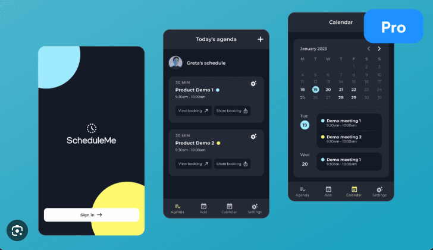
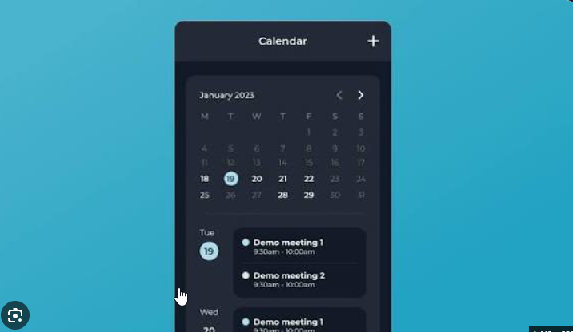

# Light-blue design direction

## References





Use the references for compact calendar grouping, rounded panels, clear date markers, concise shift cards, and simple mobile navigation. They show a different dark application: do not copy its black surfaces, yellow accents, ScheduleMe name, booking wording, or decorative Pro badge. These are visual references, not evidence of ShiftFlow features.

## Preset

User-selected code: **b2fA9jiwaO**. [Preset builder](https://ui.shadcn.com/create?preset=b2fA9jiwaO).

During Phase 1, use the official shadcn CLI in the initialized Next.js project:
```sh
pnpm dlx shadcn@latest init --preset b2fA9jiwaO
```
Check CLI help at execution time and record the actual resolved config, fonts, icons, and package versions. The [official CLI documentation](https://ui.shadcn.com/docs/cli) documents preset initialization. No preset was installed during planning; the builder could not be rendered by the text browser, so its exact settings are not claimed as verified.

Preserve the chosen preset's component structure and adjust semantic theme tokens to the user's light-blue direction. Do not substitute the old green/zinc preset.

## Proposed color tokens

These are design targets, not decoded preset values. Validate contrast before implementation.

| Use | Color |
| --- | --- |
| Page background | #F3F8FF |
| Card/input surface | #FFFFFF |
| Pale selected surface | #E5F0FF |
| Primary action | #2563EB |
| Hover/pressed primary | #1D4ED8 |
| Primary text | #172B4D |
| Secondary text | #52647C |
| Borders | #D6E3F3 |
| Success | #166534 |
| Warning | #92400E |
| Error | #B91C1C |

Use dark readable text on pale blue cards. Pair state colors with text/icons. Avoid saturated full-screen cyan backgrounds and decorative gradients.

## Layout and components

- Desktop: compact sidebar, workspace name, week navigation, prominent Generate button, coverage/hours summary, and calendar as the main work surface.
- Mobile: small header, day/week selector, grouped agenda cards, and four clear destinations: Schedule, Team, Availability, Settings. Keep touch targets generous.
- Schedule cards: employee/role, time range, lock indicator, and accessible action trigger. Today has a pale blue date marker.
- Use the preset's typography and icons once resolved; use a consistent spacing scale and restrained shadows. Target rounded cards around 12-16px if compatible with the preset, rather than changing every component independently.
- Prefer inline edits and compact panels. Longer employee/availability forms may use sheets/dialogs.
- Cascading menus remain shallow: Replace -> employee and Swap -> assignment. Do not build deep hover-only menus.
- Drag feedback shows the destination and validity before drop. Announce success/failure and provide a quick Undo.
- Generated results show concrete coverage and issues, not a generic success animation.
- On phones, allow tap-to-select then Replace/Swap as an alternative to dragging.

## Screens to deliver

| Screen/state | Main content |
| --- | --- |
| Login/signup | Email/phone choice, password, errors; no OTP/verification screen |
| Schedule empty | Setup requirements and clear path to add team/needs |
| Schedule ready | Weekly grid/day agenda, Generate, Publish update, Share |
| Generating | Progress and cancellation without blocking unrelated navigation |
| Incomplete result | Visible uncovered slots and specific reasons/search-limit state |
| Replacement menu | Eligible employees with relevant hours and unavailable reasons |
| Team | Employees, roles, active state, target hours |
| Availability | Weekly time windows plus date-specific exceptions |
| Settings | Business name/timezone, shifts, staffing, rules, informational prices |
| Shared calendar | Published week, names/roles/times, mobile readable, no manager controls |
| Print | Clean white weekly calendar, readable page breaks, no private notes |

Do not claim pixel-perfect recreation of screens not supplied. These references establish style; the above screens require original ShiftFlow layouts within that direction.

## Accessibility and review

Keyboard access, visible focus, labels, focus-managed dialogs, sufficient contrast, non-color status cues, and a no-drag equivalent are required. Check layouts at approximately 390px, 768px, and 1440px; these are review sizes, not hard breakpoints. No clipped menus or hidden primary actions. Compare matching test data and viewport sizes. Light theme is the release target; do not spend pilot time adding an unsolicited dark theme.
